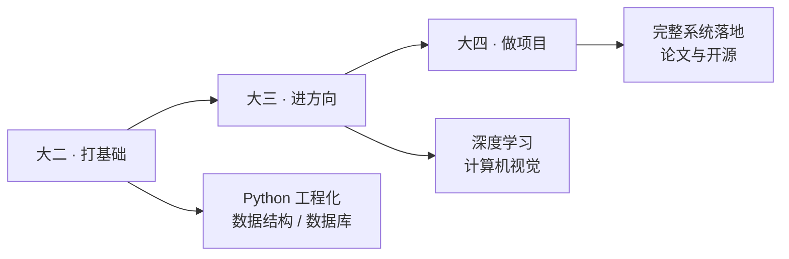

<!-- 动态横幅 -->
<div align="center">


</div>

<!-- 个人介绍 -->
<div align="center">

# 🚀 Li12668

🎓 **燕山大学 · 软件工程（大二）** &nbsp;|&nbsp; 🐍 **Python 开发者** &nbsp;|&nbsp; 🌱 **边缘计算 & AI 探索中**

[](https://github.com/Li12668)
[](https://github.com/Li12668)

</div>

## 🙋 关于我

```python
class Li12668:
    school   = "燕山大学 · 人工智能学院（软件学院）"
    major    = "软件工程"
    grade    = "大二"
    focus    = ["Python 工程化", "边缘计算", "计算机视觉应用"]
    current  = "在研：基于边缘计算的视频语义分析与隐私保护检索系统"
    motto    = "先把东西跑起来，再谈优雅"
```

- 🔭 正在做一个**边缘端视频语义分析系统**：摄像头本地提取特征 → 转成短令牌 → MQTT 上行 → 中心端检索轨迹，原始视频不出设备
- 🌱 在啃 **数据库原理** 与 **数据结构**，同时把 MQTT / MySQL 往真实项目里用
- 💬 喜欢把"能跑的最小版本"先做出来，再一点点换掉里面的玩具零件

## 🛠️ 技术栈

**编程语言**


**框架 / 工具**


**开发环境**


## 🌟 项目

<table>
<tr>
<td width="50%" valign="top">

### 🎥 video2id-tracker

**在边缘端把监控视频转成特征 ID，不上传原视频**

摄像头在本地完成特征提取，转成不可逆的短令牌，只把
`{时间, 令牌, 摄像头, 动作码}` 通过 MQTT 上行；原始视频处理后立即销毁。
中心端入库，网页按 ID 拉出全城轨迹。

`Python` `MQTT` `MySQL` `OpenCV` `边缘计算`

✅ 单帧特征 → 事件令牌
✅ MQTT 跨进程收发已验证
🚧 MySQL 入库与轨迹检索

</td>
<td width="50%" valign="top">

### 🐍 小而实的练习

| 方向 | 在做什么 |
|---|---|
| 数据处理 | 数据集清洗、文件名结构化、事件流生成 |
| 可视化 | 用网页把"同一个人跨摄像头"直接看出来 |
| 工程习惯 | Git 提交规范、离线装包、断网续传 |

📝 持续更新中，每个小工具都可独立运行

</td>
</tr>
</table>

## 📊 GitHub 数据

<div align="center">


</div>

## 🎓 学术轨迹

<details>
<summary>📚 点击展开我的学习历程</summary>

### 🏫 燕山大学

| 项目 | 内容 |
|---|---|
| 学院 | 人工智能学院（软件学院） |
| 专业 | 软件工程 |
| 年级 | 大二 |
| 状态 | 🟢 在读 |

### 📖 当前课程

| 课程 | 进度 | 状态 |
|---|---|---|
| Python 程序设计 | ███████░░░ | 🚧 深入学习中 |
| 数据结构与算法 | █████░░░░░ | 🚧 学习中 |
| 数据库原理 | ████░░░░░░ | 🚧 学习中 |
| 机器学习基础 | ██░░░░░░░░ | 📚 即将开始 |

</details>

## 📈 成长路线



## 🎯 近期目标

- [x] 搭好 GitHub 主页
- [x] 把"图片 → 事件"和"事件 → 消息"两段链路跑通
- [ ] 打通 MQTT + MySQL，用一条 SQL 查出轨迹
- [ ] 建立 Python 算法与实战仓库
- [ ] 参与一次开源项目贡献
- [ ] 掌握基础的数据爬取与可视化

## 📫 联系我

<div align="center">

[](https://github.com/Li12668)
[](mailto:2137500065@qq.com)

</div>

<!-- 波浪分割线 -->


<div align="center">

⭐ 感谢访问，期待与你交流编程的乐趣 ⭐

<!-- 贡献蛇动画：需先按 github-profile/README-部署说明.md 配好 Action，否则图片会 404 -->


</div>
